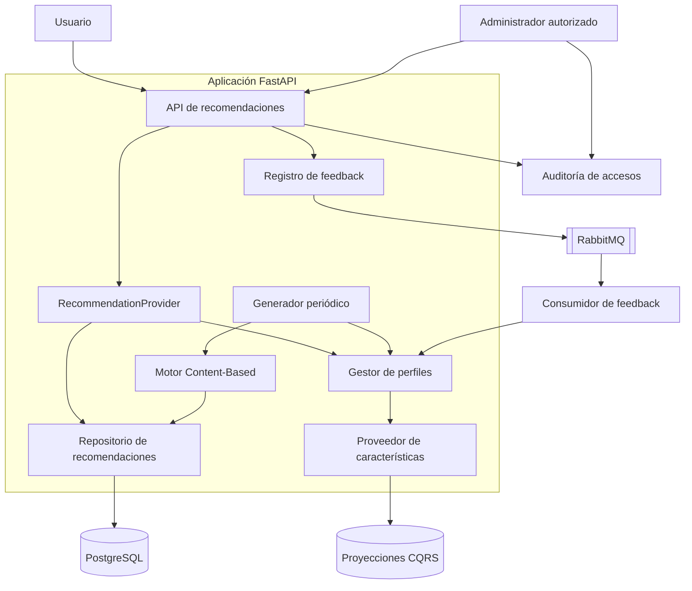

# Vista C&C — Subsistema de recomendaciones ADD-6

## Diagrama de componentes

## Responsabilidades

| Componente | Responsabilidad |
|---|---|
| API de recomendaciones | Exponer operaciones de consulta y feedback. |
| RecommendationProvider | Mantener el contrato estable del subsistema. |
| Gestor de perfiles | Obtener y actualizar las preferencias del usuario. |
| Proveedor de características | Recuperar información autorizada desde las proyecciones CQRS. |
| Motor Content-Based | Aplicar filtros y calcular similitud coseno. |
| Generador periódico | Ejecutar los ciclos de generación. |
| Repositorio | Persistir y recuperar recomendaciones. |
| Registro de feedback | Registrar las interacciones del usuario. |
| Consumidor de feedback | Procesar eventos y actualizar perfiles. |
| Auditoría | Registrar accesos administrativos a perfiles. |

## Flujo de generación

1. El generador periódico inicia el procesamiento.
2. El gestor recupera el perfil de cada usuario.
3. El proveedor de características consulta las proyecciones CQRS.
4. El motor aplica las restricciones obligatorias.
5. Se calcula la similitud coseno entre los vectores.
6. Se ordenan los alojamientos candidatos.
7. El repositorio persiste los resultados.

## Flujo de feedback

1. El usuario interactúa con una recomendación.
2. La API registra el feedback.
3. Se publica un evento en RabbitMQ.
4. El consumidor procesa el evento.
5. El perfil se actualiza asincrónicamente.
6. La nueva información se considera en el siguiente ciclo periódico.

## Comportamiento ante fallos

El repositorio conserva los últimos resultados válidos. Si el proceso de generación falla, la API continúa sirviendo resultados anteriores mientras no hayan superado el TTL.

Una vez vencidos, si no hay una nueva generación exitosa, la API devuelve una lista vacía.

La consulta de recomendaciones no debe bloquear la consulta principal de viajes y reservas.

## Consideraciones

- El diagrama representa límites lógicos y no implica que todos los componentes se desplieguen como procesos independientes.
- En el prototipo, el recomendador permanece dentro de FastAPI.
- RabbitMQ se utiliza para desacoplar el procesamiento del feedback.
- El generador periódico no depende de que el usuario realice una consulta.
- El acceso a perfiles debe respetar el contexto de autorización.
- Los accesos administrativos deben quedar auditados.
